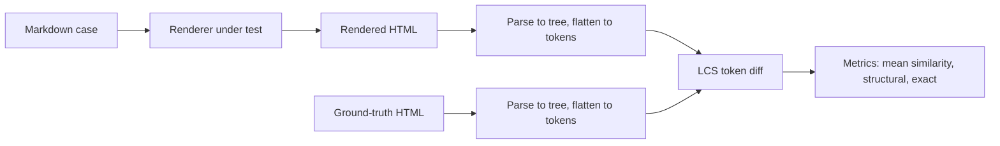

# GFM renderer comparison

<!--mdeval
import { code } from 'md-pen';

import { renderers } from './lib/renderers/index.ts';
import { computeAccuracy } from './lib/report/accuracy.ts';
import { computeSpeed } from './lib/report/speed.ts';
import { buildRendererTable, linkRenderer } from './lib/report/renderers.ts';

const accuracy = await computeAccuracy();
const speed = await computeSpeed();
const rendererTable = buildRendererTable();

// Reference-grade engines that lead the GFM-spec set; cmark-gfm only when built.
const hasCmark = renderers.some(renderer => renderer.name === 'cmark-gfm');
const specLeaders = hasCmark
	? '`micromark`, `remark-rehype`, `comrak`, and `cmark-gfm`'
	: '`micromark`, `remark-rehype`, and `comrak`';

// Fastest renderer label (linked to its repo), noting when a native C engine takes the top spot.
const fastestLabel = linkRenderer(speed.summary.fastest)
	+ (speed.summary.fastest === 'cmark-gfm' ? ' (a native C engine)' : '');
-->

Compares JavaScript GFM renderers against **GitHub's own markdown rendering** for accuracy and speed. There's no maintained drop-in "render like GitHub" package, so this benchmarks the field (pure-JS parsers, WASM/native engines, and a composed pipeline) against two ground-truth sets.

**TL;DR**

- **Closest to GitHub's output:** <!--mdeval linkRenderer(accuracy.summary.apiWinner)-->[`marked-github`](https://github.com/markedjs/marked)<!--/mdeval--> (mean similarity <!--mdeval accuracy.summary.apiWinnerSimilarity-->0.907<!--/mdeval-->, structural <!--mdeval accuracy.summary.apiWinnerStructural-->50.9%<!--/mdeval-->). A composed pipeline, not a single engine.
- **Most accurate raw engine** (vs the GFM spec): <!--mdeval linkRenderer(accuracy.summary.specWinner)-->[`remark-rehype`](https://github.com/remarkjs/remark-gfm)<!--/mdeval--> (mean similarity <!--mdeval accuracy.summary.specWinnerSimilarity-->0.993<!--/mdeval-->).
- **Fastest:** <!--mdeval fastestLabel-->[`hoedown`](https://github.com/hoedown/node-hoedown)<!--/mdeval-->.
- **Best all-rounder:** <!--mdeval linkRenderer('comrak')-->[`comrak`](https://github.com/kivikakk/comrak)<!--/mdeval-->, with reference-grade accuracy (matches <!--mdeval linkRenderer('cmark-gfm')-->[`cmark-gfm`](https://github.com/BinaryMuse/node-cmark-gfm)<!--/mdeval--> across the GFM spec) at native Rust speed.

**Renderers** (<!--mdeval renderers.length-->18<!--/mdeval-->), ordered by most recent commit so the least-maintained sink to the bottom:

<!--mdeval block(rendererTable)-->
| Renderer | Version | Published | Last commit |
| - | - | - | - |
| [`pulldown-cmark`](https://github.com/raphlinus/pulldown-cmark) | [`0.13.4`](https://crates.io/crates/pulldown-cmark/0.13.4) | 2026-05-20 | [2026-06-01](https://github.com/pulldown-cmark/pulldown-cmark/commit/7d05556009be40944313fcf0f8aa7882ec7ab5f8) |
| [`marked`](https://github.com/markedjs/marked) | [`18.0.4`](https://www.npmjs.com/package/marked/v/18.0.4) | 2026-05-19 | [2026-06-01](https://github.com/markedjs/marked/commit/c1a86f00ccd81144422f1a4194756bd48111c531) |
| [`marked-github`](https://github.com/markedjs/marked) | [`marked@18.0.4`](https://www.npmjs.com/package/marked/v/18.0.4) | 2026-05-19 | [2026-06-01](https://github.com/markedjs/marked/commit/c1a86f00ccd81144422f1a4194756bd48111c531) |
| [`markdown-it`](https://github.com/markdown-it/markdown-it) | [`14.2.0`](https://www.npmjs.com/package/markdown-it/v/14.2.0) | 2026-05-23 | [2026-05-26](https://github.com/markdown-it/markdown-it/commit/83450e2bc3836ad9f68f652e5685031e9dce4897) |
| [`comrak`](https://github.com/kivikakk/comrak) | [`0.52.0`](https://crates.io/crates/comrak/0.52.0) | 2026-04-04 | [2026-05-19](https://github.com/kivikakk/comrak/commit/d2da7a055008a8ccde18cc1c88a06a04de69fa99) |
| [`simple-markdown`](https://github.com/Khan/perseus/tree/HEAD/packages/simple-markdown) | [`@khanacademy/simple-markdown@2.2.3`](https://www.npmjs.com/package/@khanacademy/simple-markdown/v/2.2.3) | 2026-05-07 | [2026-05-07](https://github.com/Khan/perseus/commit/2a9ddcad17afb38a274720def487f338ccdc8dec) |
| [`commonmark`](https://github.com/commonmark/commonmark.js) | [`0.31.2`](https://www.npmjs.com/package/commonmark/v/0.31.2) | 2024-09-19 | [2026-03-01](https://github.com/commonmark/commonmark.js/commit/497bdcc8f8bf8400e99d7741f049233820048c8a) |
| [`showdown`](https://github.com/showdownjs/showdown) | [`2.1.0`](https://www.npmjs.com/package/showdown/v/2.1.0) | 2022-04-21 | [2026-01-02](https://github.com/showdownjs/showdown/commit/2a8a64eb3dd137dc456fd016322a78cde66136d7) |
| [`md4w`](https://github.com/ije/md4w) | [`0.2.7`](https://www.npmjs.com/package/md4w/v/0.2.7) | 2025-05-28 | [2025-05-28](https://github.com/ije/md4w/commit/1ae005b08cfe9286ba22752b52ea244d91101f3a) |
| [`micromark`](https://github.com/micromark/micromark) | [`4.0.2`](https://www.npmjs.com/package/micromark/v/4.0.2) | 2025-02-27 | [2025-05-10](https://github.com/micromark/micromark/commit/774a70c6bae6dd94486d3385dbd9a0f14550b709) |
| [`markdown-rs`](https://github.com/wooorm/markdown-rs) | [`markdown@1.0.0`](https://crates.io/crates/markdown/1.0.0) | 2025-04-23 | [2025-04-23](https://github.com/wooorm/markdown-rs/commit/1506572f9b406431402928f3a8b3df0b4ae2d8f5) |
| [`remark-rehype`](https://github.com/remarkjs/remark-gfm) | [`remark-gfm@4.0.1`](https://www.npmjs.com/package/remark-gfm/v/4.0.1) | 2025-02-10 | [2025-02-10](https://github.com/remarkjs/remark-gfm/commit/109972e8a773bf5dac1d6d2da0776557f36971aa) |
| [`nano-markdown`](https://github.com/Holixus/nano-markdown) | [`1.2.2`](https://www.npmjs.com/package/nano-markdown/v/1.2.2) | 2023-03-07 | [2023-03-07](https://github.com/Holixus/nano-markdown/commit/29995759dbc164f1757fbdeadd718ab137ac2a72) |
| [`cmark-gfm`](https://github.com/BinaryMuse/node-cmark-gfm) | [`0.9.0`](https://www.npmjs.com/package/cmark-gfm/v/0.9.0) | 2021-04-21 | [2022-06-27](https://github.com/BinaryMuse/node-cmark-gfm/commit/6e2300fb7b7a2e2d47251381e1078440d435859d) |
| [`snarkdown`](https://github.com/developit/snarkdown) | [`2.0.0`](https://www.npmjs.com/package/snarkdown/v/2.0.0) | 2020-08-31 | [2022-01-10](https://github.com/developit/snarkdown/commit/7619436b10a3e31e6779bf1209da4762409b86be) |
| [`micro-down`](https://github.com/commit-intl/micro-down) | [`1.6.2`](https://www.npmjs.com/package/micro-down/v/1.6.2) | 2021-05-25 | [2021-05-25](https://github.com/commit-intl/micro-down/commit/5fef893b27a4ca902a34741827676bcdcb1775be) |
| [`markdown`](https://github.com/evilstreak/markdown-js) | [`0.5.0`](https://www.npmjs.com/package/markdown/v/0.5.0) | 2013-07-26 | [2019-03-05](https://github.com/evilstreak/markdown-js/commit/14344a8f0eb1ca5d6ff99eb3fa54c1fd821bf484) |
| [`hoedown`](https://github.com/hoedown/node-hoedown) | [`0.4.1`](https://www.npmjs.com/package/hoedown/v/0.4.1) | 2015-06-25 | [2015-06-25](https://github.com/hoedown/node-hoedown/commit/77bb83f7720cd55e340538dd5a566de98d47eadd) |
<!--/mdeval-->

## Methodology

Each renderer is configured in its most GitHub-like mode (all GFM extensions on, raw HTML passed through, no smartypants, soft line breaks), then run against two ground-truth sets:

1. **GitHub API**: `POST https://api.github.com/markdown` (`mode: gfm`, no repo context), cached beside each case as `corpus/<category>/<id>.html`. The real "render like a README" target, including GitHub's sanitization and post-processing.
2. **[Official GFM spec](https://github.github.com/gfm/)**: the <!--mdeval accuracy.specTotal-->672<!--/mdeval--> cmark-gfm reference examples (`corpus/spec.json`), unsanitized and decoration-free.

Outputs are compared with no lossy pre-normalization: each is parsed to an HTML tree and flattened to a token stream, then an [LCS](https://en.wikipedia.org/wiki/Longest_common_subsequence) diff reports *every* differing token, categorized (tag / attribute / text / comment). Parsing ignores only genuinely insignificant things: attribute order, inter-block whitespace, and boolean-attribute spelling.

Three metrics summarize each renderer against a target:

- **Mean similarity**: mean [Sørensen–Dice](https://en.wikipedia.org/wiki/Dice-S%C3%B8rensen_coefficient) structural similarity over the token streams; 1.0 = structurally identical.
- **Structural**: % of cases with *zero* tree diffs.
- **Exact**: % byte-identical (strictest).

## Accuracy

### vs GitHub API (<!--mdeval accuracy.total-->108<!--/mdeval--> cases)

<!--mdeval block(accuracy.apiChart)-->
<picture>
	<source media="(prefers-color-scheme: dark)" srcset="https://quickchart.io/chart?c=%7Btype%3A%27bar%27%2Cdata%3A%7Blabels%3A%5B%27marked-github%27%2C%27micromark%27%2C%27remark-rehype%27%2C%27comrak%27%2C%27cmark-gfm%27%2C%27marked%27%2C%27markdown-it%27%2C%27pulldown-cmark%27%2C%27md4w%27%2C%27markdown-rs%27%2C%27showdown%27%2C%27hoedown%27%2C%27commonmark%27%2C%27micro-down%27%2C%27markdown%27%2C%27simple-markdown%27%2C%27nano-markdown%27%2C%27snarkdown%27%5D%2Cdatasets%3A%5B%7Blabel%3A%27Mean+similarity%27%2Cdata%3A%5B0.907%2C0.87%2C0.869%2C0.868%2C0.867%2C0.859%2C0.853%2C0.843%2C0.835%2C0.812%2C0.802%2C0.8%2C0.76%2C0.693%2C0.65%2C0.627%2C0.622%2C0.61%5D%2CbackgroundColor%3A%5B%27hsla%28184%2C+74%25%2C+55%25%2C+0.7%29%27%2C%27hsla%28334%2C+73%25%2C+56%25%2C+0.7%29%27%2C%27hsla%28339%2C+76%25%2C+55%25%2C+0.7%29%27%2C%27hsla%28197%2C+72%25%2C+44%25%2C+0.7%29%27%2C%27hsla%2887%2C+73%25%2C+50%25%2C+0.7%29%27%2C%27hsla%28160%2C+72%25%2C+57%25%2C+0.7%29%27%2C%27hsla%28245%2C+74%25%2C+51%25%2C+0.7%29%27%2C%27hsla%28121%2C+69%25%2C+55%25%2C+0.7%29%27%2C%27hsla%28262%2C+78%25%2C+54%25%2C+0.7%29%27%2C%27hsla%28137%2C+81%25%2C+47%25%2C+0.7%29%27%2C%27hsla%28357%2C+73%25%2C+52%25%2C+0.7%29%27%2C%27hsla%2837%2C+81%25%2C+44%25%2C+0.7%29%27%2C%27hsla%28235%2C+70%25%2C+49%25%2C+0.7%29%27%2C%27hsla%28170%2C+72%25%2C+51%25%2C+0.7%29%27%2C%27hsla%284%2C+70%25%2C+44%25%2C+0.7%29%27%2C%27hsla%28192%2C+80%25%2C+46%25%2C+0.7%29%27%2C%27hsla%28332%2C+74%25%2C+54%25%2C+0.7%29%27%2C%27hsla%28209%2C+72%25%2C+51%25%2C+0.7%29%27%5D%2CborderColor%3A%5B%27hsla%28184%2C+74%25%2C+55%25%2C+1%29%27%2C%27hsla%28334%2C+73%25%2C+56%25%2C+1%29%27%2C%27hsla%28339%2C+76%25%2C+55%25%2C+1%29%27%2C%27hsla%28197%2C+72%25%2C+44%25%2C+1%29%27%2C%27hsla%2887%2C+73%25%2C+50%25%2C+1%29%27%2C%27hsla%28160%2C+72%25%2C+57%25%2C+1%29%27%2C%27hsla%28245%2C+74%25%2C+51%25%2C+1%29%27%2C%27hsla%28121%2C+69%25%2C+55%25%2C+1%29%27%2C%27hsla%28262%2C+78%25%2C+54%25%2C+1%29%27%2C%27hsla%28137%2C+81%25%2C+47%25%2C+1%29%27%2C%27hsla%28357%2C+73%25%2C+52%25%2C+1%29%27%2C%27hsla%2837%2C+81%25%2C+44%25%2C+1%29%27%2C%27hsla%28235%2C+70%25%2C+49%25%2C+1%29%27%2C%27hsla%28170%2C+72%25%2C+51%25%2C+1%29%27%2C%27hsla%284%2C+70%25%2C+44%25%2C+1%29%27%2C%27hsla%28192%2C+80%25%2C+46%25%2C+1%29%27%2C%27hsla%28332%2C+74%25%2C+54%25%2C+1%29%27%2C%27hsla%28209%2C+72%25%2C+51%25%2C+1%29%27%5D%2CborderWidth%3A1%7D%5D%7D%2Coptions%3A%7Bscales%3A%7Bx%3A%7Bticks%3A%7Bcolor%3A%27%23f0f6fc%27%2CmaxRotation%3A45%2CminRotation%3A45%7D%2Cgrid%3A%7Bdisplay%3Afalse%7D%7D%2Cy%3A%7Bmin%3A0%2Cmax%3A1%2Cticks%3A%7Bcolor%3A%27%23f0f6fc%27%2Cfont%3A%7Bsize%3A10%7D%7D%2Ctitle%3A%7Bdisplay%3Atrue%2Ctext%3A%27Mean+similarity%27%2Ccolor%3A%27%23f0f6fc%27%2Cfont%3A%7Bsize%3A14%7D%7D%2Cgrid%3A%7Bcolor%3A%27%23f0f6fc1a%27%7D%7D%7D%2Cplugins%3A%7Btitle%3A%7Bdisplay%3Atrue%2Ctext%3A%27Mean+similarity+to+the+GitHub+API%27%2Ccolor%3A%27%23f0f6fc%27%2Cfont%3A%7Bsize%3A20%7D%7D%2Clegend%3A%7Bdisplay%3Afalse%7D%2Cdatalabels%3A%7Banchor%3A%27end%27%2Calign%3A%27top%27%2Cformatter%3A%28value++++++++%29+%3D%3E+value.toFixed%283%29%2Ccolor%3A%27%23f0f6fc%27%2Cfont%3A%7Bsize%3A10%7D%7D%7D%7D%7D&w=900&h=400&ref=qc-js&bkg=transparent&f=svg&v=4">
	
</picture>
<!--/mdeval-->

Each renderer name links to its full diff against GitHub: every differing case, line by line (`expected/` in those diffs is GitHub's API output).

<!--mdeval block(accuracy.apiTable)-->
| Rank | Renderer | Mean similarity | Structural | Exact |
| - | - | - | - | - |
| 1 | [marked-github](results/diffs/marked-github.diff) | 0.907 | 50.9% | 3.7% |
| 2 | [micromark](results/diffs/micromark.diff) | 0.870 | 40.7% | 35.2% |
| 3 | [remark-rehype](results/diffs/remark-rehype.diff) | 0.869 | 39.8% | 37.0% |
| 4 | [comrak](results/diffs/comrak.diff) | 0.868 | 40.7% | 0.0% |
| 5 | [cmark-gfm](results/diffs/cmark-gfm.diff) | 0.867 | 40.7% | 0.0% |
| 6 | [marked](results/diffs/marked.diff) | 0.859 | 39.8% | 3.7% |
| 7 | [markdown-it](results/diffs/markdown-it.diff) | 0.853 | 37.0% | 6.5% |
| 8 | [pulldown-cmark](results/diffs/pulldown-cmark.diff) | 0.843 | 38.9% | 6.5% |
| 9 | [md4w](results/diffs/md4w.diff) | 0.835 | 34.3% | 0.0% |
| 10 | [markdown-rs](results/diffs/markdown-rs.diff) | 0.812 | 29.6% | 25.0% |
| 11 | [showdown](results/diffs/showdown.diff) | 0.802 | 31.5% | 19.4% |
| 12 | [hoedown](results/diffs/hoedown.diff) | 0.800 | 29.6% | 0.0% |
| 13 | [commonmark](results/diffs/commonmark.diff) | 0.760 | 36.1% | 0.0% |
| 14 | [micro-down](results/diffs/micro-down.diff) | 0.693 | 20.4% | 8.3% |
| 15 | [markdown](results/diffs/markdown.diff) | 0.650 | 18.5% | 5.6% |
| 16 | [simple-markdown](results/diffs/simple-markdown.diff) | 0.627 | 3.7% | 0.0% |
| 17 | [nano-markdown](results/diffs/nano-markdown.diff) | 0.622 | 14.8% | 3.7% |
| 18 | [snarkdown](results/diffs/snarkdown.diff) | 0.610 | 4.6% | 0.0% |
<!--/mdeval-->

Per-category mean similarity (all corpus categories)

<!--mdeval block(accuracy.apiByCategory)-->
| Rank | Renderer | comments | commonmark | edge | gfm | github | markdown-in-html |
| - | - | - | - | - | - | - | - |
| 1 | marked-github | 0.663 | 0.948 | 0.956 | 0.943 | 0.891 | 0.983 |
| 2 | micromark | 0.639 | 0.932 | 0.919 | 0.945 | 0.698 | 0.983 |
| 3 | remark-rehype | 0.639 | 0.932 | 0.919 | 0.941 | 0.698 | 0.983 |
| 4 | comrak | 0.639 | 0.932 | 0.919 | 0.945 | 0.681 | 0.983 |
| 5 | cmark-gfm | 0.639 | 0.932 | 0.919 | 0.945 | 0.674 | 0.983 |
| 6 | marked | 0.639 | 0.932 | 0.919 | 0.931 | 0.625 | 0.983 |
| 7 | markdown-it | 0.639 | 0.932 | 0.919 | 0.893 | 0.625 | 0.983 |
| 8 | pulldown-cmark | 0.639 | 0.932 | 0.919 | 0.821 | 0.642 | 0.983 |
| 9 | md4w | 0.605 | 0.899 | 0.907 | 0.910 | 0.611 | 0.958 |
| 10 | markdown-rs | 0.576 | 0.893 | 0.898 | 0.945 | 0.694 | 0.733 |
| 11 | showdown | 0.571 | 0.929 | 0.848 | 0.828 | 0.652 | 0.833 |
| 12 | hoedown | 0.554 | 0.901 | 0.874 | 0.803 | 0.663 | 0.877 |
| 13 | commonmark | 0.494 | 0.932 | 0.884 | 0.493 | 0.625 | 0.983 |
| 14 | micro-down | 0.426 | 0.831 | 0.811 | 0.673 | 0.569 | 0.681 |
| 15 | markdown | 0.407 | 0.854 | 0.792 | 0.504 | 0.609 | 0.535 |
| 16 | simple-markdown | 0.471 | 0.702 | 0.674 | 0.703 | 0.520 | 0.581 |
| 17 | nano-markdown | 0.357 | 0.772 | 0.741 | 0.497 | 0.622 | 0.605 |
| 18 | snarkdown | 0.404 | 0.755 | 0.680 | 0.439 | 0.493 | 0.759 |
<!--/mdeval-->

### vs official GFM spec (<!--mdeval accuracy.specTotal-->672<!--/mdeval--> examples)

Reference HTML from the cmark-gfm spec suite (unsanitized; no `rel="nofollow"`, no GitHub decorations). Columns after Exact are mean similarity on each GFM extension section.

<!--mdeval block(accuracy.specTable)-->
| Rank | Renderer | Mean similarity | Structural | Exact |
| - | - | - | - | - |
| 1 | remark-rehype | 0.993 | 97.3% | 81.0% |
| 2 | micromark | 0.992 | 96.7% | 87.2% |
| 3 | comrak | 0.988 | 95.4% | 0.3% |
| 4 | markdown-it | 0.988 | 94.6% | 4.6% |
| 5 | pulldown-cmark | 0.986 | 94.6% | 4.6% |
| 6 | cmark-gfm | 0.986 | 94.9% | 0.3% |
| 7 | marked | 0.982 | 93.5% | 3.7% |
| 8 | commonmark | 0.977 | 93.5% | 0.3% |
| 9 | marked-github | 0.977 | 90.0% | 8.8% |
| 10 | md4w | 0.960 | 87.4% | 0.3% |
| 11 | markdown-rs | 0.936 | 86.6% | 77.2% |
| 12 | hoedown | 0.821 | 55.5% | 0.3% |
| 13 | showdown | 0.805 | 47.3% | 33.0% |
| 14 | markdown | 0.735 | 41.1% | 23.1% |
| 15 | micro-down | 0.636 | 25.3% | 14.4% |
| 16 | nano-markdown | 0.586 | 21.0% | 8.9% |
| 17 | snarkdown | 0.503 | 3.6% | 2.1% |
| 18 | simple-markdown | 0.461 | 7.6% | 1.8% |
<!--/mdeval-->

Per-extension mean similarity (each GFM extension section)

<!--mdeval block(accuracy.specByExtension)-->
| Rank | Renderer | Tables | Task list items | Strikethrough | Autolinks | Disallowed Raw HTML |
| - | - | - | - | - | - | - |
| 1 | remark-rehype | 1.000 | 0.927 | 1.000 | 0.988 | 0.571 |
| 2 | micromark | 1.000 | 1.000 | 1.000 | 0.988 | 1.000 |
| 3 | comrak | 1.000 | 1.000 | 1.000 | 1.000 | 1.000 |
| 4 | markdown-it | 0.981 | 0.884 | 0.875 | 0.866 | 0.571 |
| 5 | pulldown-cmark | 0.971 | 1.000 | 1.000 | 0.605 | 0.571 |
| 6 | cmark-gfm | 1.000 | 1.000 | 1.000 | 1.000 | 1.000 |
| 7 | marked | 1.000 | 1.000 | 1.000 | 1.000 | 0.571 |
| 8 | commonmark | 0.365 | 0.533 | 0.808 | 0.605 | 0.571 |
| 9 | marked-github | 1.000 | 1.000 | 1.000 | 0.956 | 0.571 |
| 10 | md4w | 0.888 | 0.850 | 1.000 | 0.807 | 0.571 |
| 11 | markdown-rs | 1.000 | 1.000 | 1.000 | 0.988 | 0.579 |
| 12 | hoedown | 0.885 | 0.533 | 1.000 | 0.990 | 0.571 |
| 13 | showdown | 0.757 | 0.864 | 1.000 | 0.907 | 0.571 |
| 14 | markdown | 0.356 | 0.533 | 0.808 | 0.594 | 0.550 |
| 15 | micro-down | 0.552 | 0.533 | 0.667 | 0.597 | 0.550 |
| 16 | nano-markdown | 0.319 | 0.533 | 1.000 | 0.610 | 0.571 |
| 17 | snarkdown | 0.338 | 0.458 | 0.436 | 0.273 | 0.550 |
| 18 | simple-markdown | 0.757 | 0.533 | 0.603 | 0.229 | 0.429 |
<!--/mdeval-->

## Speed

Single mixed workload: the entire <!--mdeval speed.corpusKb-->6.3<!--/mdeval--> KB fixture corpus rendered per op (`mitata`, <!--mdeval speed.context-->node 24.14.0, Apple M5 Pro<!--/mdeval-->).

> [!NOTE]
> Throughput is a single-machine snapshot from one run, so treat the figures as relative, not absolute. `hoedown` and `pulldown-cmark` sit within run-to-run noise of each other, so the top spot can swap between runs.

<!--mdeval block(speed.table)-->
| Rank | Renderer | Avg / render | Throughput | Relative |
| - | - | - | - | - |
| 1 | hoedown | 0.038 ms | 26,180 ops/s | 1.00× (fastest) |
| 2 | pulldown-cmark | 0.040 ms | 25,180 ops/s | 1.04× slower |
| 3 | md4w | 0.054 ms | 18,517 ops/s | 1.41× slower |
| 4 | nano-markdown | 0.091 ms | 11,030 ops/s | 2.37× slower |
| 5 | comrak | 0.108 ms | 9,217 ops/s | 2.84× slower |
| 6 | cmark-gfm | 0.125 ms | 7,980 ops/s | 3.28× slower |
| 7 | snarkdown | 0.153 ms | 6,553 ops/s | 4.00× slower |
| 8 | commonmark | 0.169 ms | 5,931 ops/s | 4.41× slower |
| 9 | marked | 0.306 ms | 3,267 ops/s | 8.01× slower |
| 10 | micro-down | 0.307 ms | 3,258 ops/s | 8.04× slower |
| 11 | markdown-it | 0.317 ms | 3,154 ops/s | 8.30× slower |
| 12 | markdown | 0.575 ms | 1,738 ops/s | 15.07× slower |
| 13 | marked-github | 0.784 ms | 1,275 ops/s | 20.53× slower |
| 14 | markdown-rs | 0.787 ms | 1,271 ops/s | 20.59× slower |
| 15 | simple-markdown | 0.791 ms | 1,264 ops/s | 20.72× slower |
| 16 | showdown | 1.482 ms | 675 ops/s | 38.80× slower |
| 17 | micromark | 3.763 ms | 266 ops/s | 98.51× slower |
| 18 | remark-rehype | 5.247 ms | 191 ops/s | 137.36× slower |
<!--/mdeval-->

## Verdict

### Accuracy

- **Closest to GitHub (API set):** <!--mdeval code(accuracy.summary.apiWinner)-->`marked-github`<!--/mdeval-->, mean similarity <!--mdeval accuracy.summary.apiWinnerSimilarity-->0.907<!--/mdeval-->, structural match <!--mdeval accuracy.summary.apiWinnerStructural-->50.9%<!--/mdeval-->.
- **Closest to the GFM spec:** <!--mdeval code(accuracy.summary.specWinner)-->`remark-rehype`<!--/mdeval-->, mean similarity <!--mdeval accuracy.summary.specWinnerSimilarity-->0.993<!--/mdeval-->.
- The composed **`marked-github`** pipeline (marked + highlight.js + GitHub alerts + footnotes + emoji + `rel="nofollow"`) tops the API set: adding GitHub's post-processing closes far more of the gap than any single engine can. Among raw engines, the reference-grade ones (<!--mdeval specLeaders-->`micromark`, `remark-rehype`, `comrak`, and `cmark-gfm`<!--/mdeval-->) cluster at the top and lead the GFM-spec set.
- On the spec set (pure GFM correctness, no GitHub chrome), those engines reach ≈0.99 mean similarity to the reference. `commonmark` collapses on tables/task lists (no GFM), and the tiny parsers (`snarkdown`, `nano-markdown`, `simple-markdown`) and `showdown` diverge the most.

### Speed

- **Fastest:** <!--mdeval fastestLabel-->[`hoedown`](https://github.com/hoedown/node-hoedown)<!--/mdeval-->. **Slowest:** <!--mdeval code(speed.summary.slowest)-->`remark-rehype`<!--/mdeval-->.
- **Native engines lead throughput**: the directly-bound Rust crates (`pulldown-cmark`, `comrak`), native C (`hoedown`, `cmark-gfm`), and the [md4c](https://github.com/mity/md4c) WASM build `md4w`. The unified/micromark pipeline (`micromark`, `remark-rehype`) is slowest (trading speed for correctness), and `marked-github` pays for running syntax highlighting.
- **`comrak` is a strong all-rounder:** reference-grade accuracy (matching `cmark-gfm` on every GFM-spec extension) at native Rust speed.

### Why no renderer is byte-identical to the API

The residual gap to the GitHub API is almost entirely GitHub **post-processing that lives outside any markdown renderer**:

- `rel="nofollow"` added to every link.
- Server-side **syntax highlighting** of fenced code (``).
- **Image proxying** through `camo.githubusercontent.com` + wrapping links.
- **Alerts** (`> [!NOTE]`) rendered with injected octicon SVGs.
- **`@mention`** hovercard links and **emoji** shortcode → Unicode substitution.
- Task-list ARIA attributes (`aria-label`, `id`, `class="task-list-item-checkbox"`).
- HTML sanitization (e.g. stripping `class` from raw `
`s) and the tagfilter.
- HTML **comments stripped** as raw HTML, but kept literal inside code spans/blocks (with `class="notranslate"`), split by `|` in tables, and *unclosed* comments escaped as text. This `comments` category is the hardest: all renderers manage only 1/15 structural matches.

For pure **GFM correctness**, <!--mdeval specLeaders-->`micromark`, `remark-rehype`, `comrak`, and `cmark-gfm`<!--/mdeval--> are effectively exact. To *visually* reproduce GitHub, any of them still needs a post-processing layer (highlighter, link/image rewriting, alert + emoji plugins), which is exactly what `marked-github` demonstrates.

### Landscape notes

The <!--mdeval renderers.length-->18<!--/mdeval--> renderers span pure-JS parsers, official Rust crates bound directly via [N-API](https://nodejs.org/api/n-api.html) (`pulldown-cmark`, `comrak`, `markdown-rs`), native C bindings (`cmark-gfm`; `hoedown` via a hand-written N-API binding since its bundled V8 binding no longer compiles on Node 24), a WASM build of md4c (`md4w`), and a composed GitHub-emulation pipeline. Findings from widening the search:

- There is **no maintained drop-in "GitHub renderer" package**: `hubdown` does only emoji + slugs (no GFM), and `marky-markdown` is deprecated with a native dep that fails to build. You compose one.
- **Old native bindings don't build on modern Node**: `hoedown`/`sundown`-era addons use V8 APIs removed since ~2016; a minimal N-API shim over their intact C engine is the workaround.
- **Tiny parsers** (`snarkdown`, `nano-markdown`, `micro-down`, `simple-markdown`, `markdown`) implement little or no GFM, so they work as size baselines but aren't GitHub-faithful.
